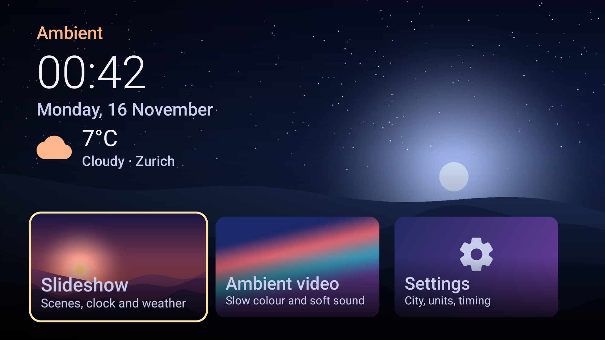
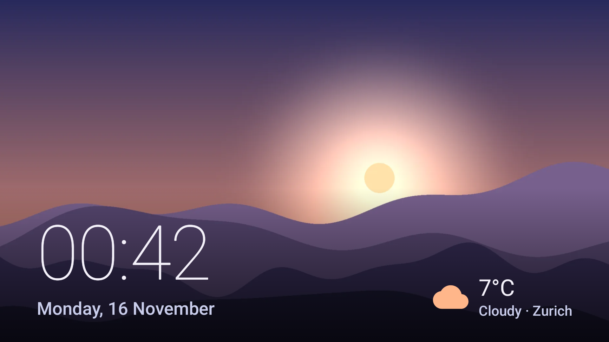
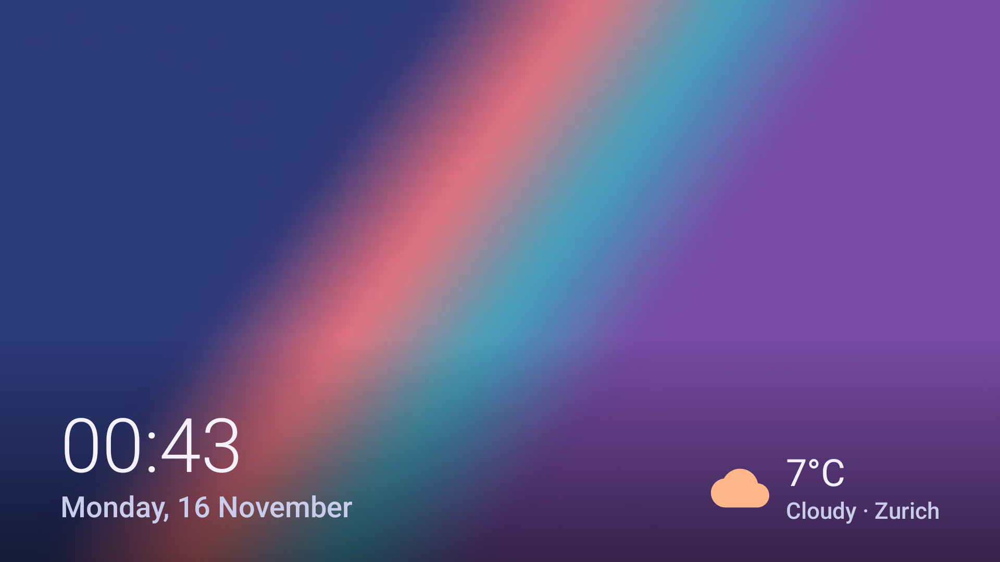
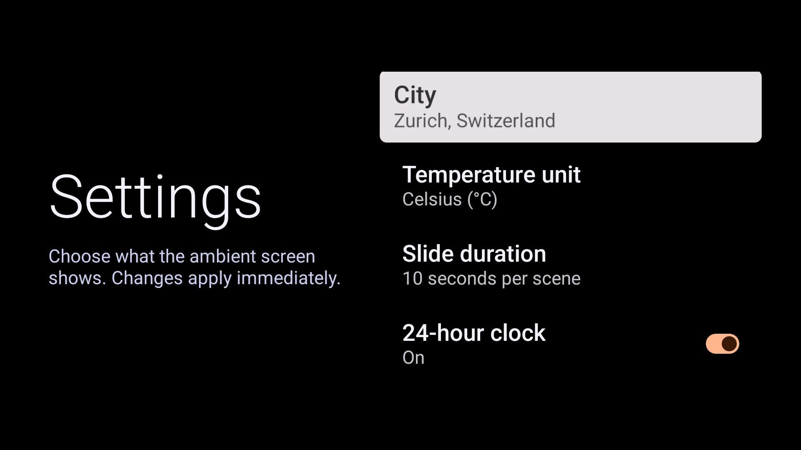
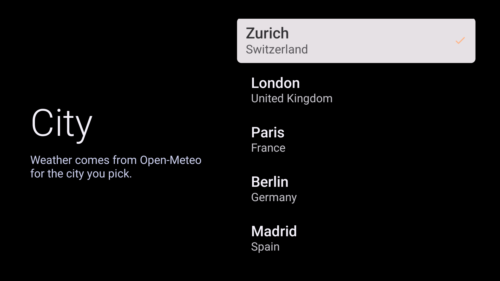
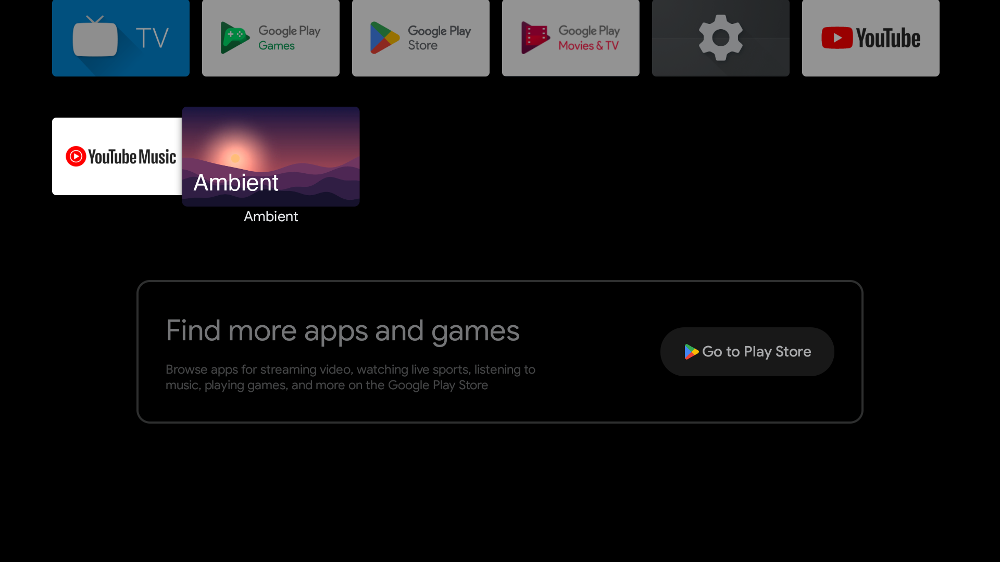
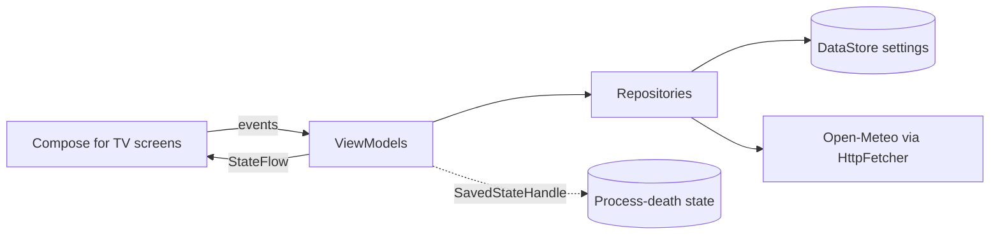

# Ambient

[](https://github.com/informramiz/tv-showcase/actions/workflows/ci.yml)

An Android TV ambient screen built with Compose for TV. It plays a full-screen slideshow of
bundled, generated artwork with a clock and live weather overlay, and has a Media3 ambient video
mode with sound. Everything is driven from the D-pad.

<p>
  
  
</p>
<p>
  
  
</p>
<p>
  
  
</p>

More captures from the emulator run are in [docs/demo](docs/demo).

## Features

- **Home**: clock, date and weather over a night scene, with three cards (Slideshow, Ambient
  video, Settings). Focus returns to the card you came from.
- **Slideshow**: bundled images. Left/Right change scene, OK pauses and resumes, Back returns.
  Position and pause state survive process death.
- **Weather**: [Open-Meteo](https://open-meteo.com) (no API key) for the city chosen in Settings.
- **Ambient video**: Media3 ExoPlayer plays a bundled looping video with sound. OK plays/pauses,
  Up/Down toggle mute. Play and mute state survive process death.
- **Settings**: city, temperature unit, slide duration, 24-hour clock. Changes apply immediately
  and persist in DataStore.
- Manifest: `LEANBACK_LAUNCHER`, `android.software.leanback` and touchscreen not required, TV banner.

## Architecture

MVVM with unidirectional data flow. Screens render a `StateFlow` of UI state and send events to
a Hilt `ViewModel`; repositories expose `Flow`s.



| Module | Contents |
|---|---|
| `:core:model` | Plain Kotlin models: `City`, `Weather`, `AmbientSettings`, `AmbientInfo` |
| `:core:data` | `SettingsRepository` (DataStore), `WeatherRepository` and Open-Meteo client, `ClockRepository`, Hilt module |
| `:app` | `MainActivity`, Navigation3 back stack, screens and ViewModels |

Stack: Kotlin, `androidx.tv:tv-material`, Navigation3, Media3, Hilt, DataStore, coroutines/Flow.

## Run

Needs JDK 17+ and the Android SDK. Open in Android Studio, or use Gradle:

```bash
./gradlew :app:installDebug   # to a running Android TV emulator or device
```

Use a TV system image (for example `system-images;android-36;android-tv;arm64-v8a`) and start
Ambient from the launcher's Apps row. Weather needs network access.

Checks (the same as CI):

```bash
./gradlew ktlintCheck test lint assembleDebug
```

## Tests

JVM unit tests cover the settings, weather and clock repositories and the ViewModels (Turbine).
Compose UI tests (Robolectric) cover the screens.

## Media

Images, video and soundtrack are generated by `tools/generate_assets.py`; there are no
third-party assets.

## CI

GitHub Actions on a self-hosted runner (`runs-on: [self-hosted, buildpc]`, skipped for fork PRs):
ktlint, unit tests, Android lint, assemble.
